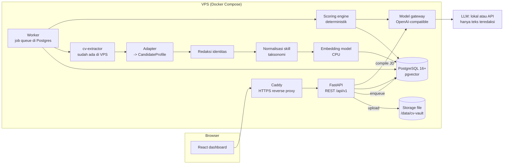

# 03 — System Architecture & Pipeline Blueprint

## 1. Gambaran besar

Satu aplikasi **modular monolith** (satu codebase FastAPI) dengan proses worker terpisah, satu database
PostgreSQL (+ pgvector), penyimpanan file, dan frontend React. Semua jalan di satu VPS dengan Docker Compose.

Ada empat jalur yang dipisah supaya pekerjaan berat tidak terjadi saat recruiter membuka halaman:

| Jalur | Kapan | Isi |
| --- | --- | --- |
| **Ingestion** (offline, async) | Saat CV diunggah | Validasi → simpan → ekstraksi → redaksi → normalisasi skill → embedding. **Sekali per file.** |
| **Requirement** (interaktif) | Saat JD dimasukkan | Draf kriteria oleh LLM → policy linter → recruiter edit dan setujui |
| **Screening** (async, cepat) | Saat recruiter klik "Mulai screening" | Penilaian per kriteria → skor → ranking → penjelasan |
| **Evaluasi** (offline) | Setiap perubahan kode/model + terjadwal | Golden dataset + `evaluate.py` |



## 2. Pipeline data langkah demi langkah

### 2.1 Ingestion (per file)

| # | Langkah | Detail | Output |
| --- | --- | --- | --- |
| 1 | Terima upload | `POST /jobs/{id}/cvs` multipart atau ZIP. Batas 10 MB/file, 20 halaman, 500 file/batch | Baris `documents` status `RECEIVED` |
| 2 | Validasi | MIME dari magic bytes (bukan ekstensi): PDF, DOCX, DOC, PNG, JPG. Tolak terenkripsi, makro, arsip bersarang | `REJECTED` + alasan, atau lanjut |
| 3 | Scan malware | ClamAV (`clamd`) | Kalau terinfeksi: karantina + `REJECTED` |
| 4 | Hash & dedup | SHA-256 bytes. Sama dengan file lain di lowongan yang sama → `DUPLICATE` | `sha256`, `duplicate_of` |
| 5 | Simpan | `/data/cv-vault/{tenant}/{sha256}.{ext}`, permission 600, tidak bisa diakses langsung dari web | `storage_key` |
| 6 | Ekstraksi | Panggil **`cv-extractor`** yang sudah ada | JSON mentah extractor |
| 7 | Adapter | Ubah output extractor ke `CandidateProfile` (`schemas/candidate_profile.schema.json`). Lengkapi `source` (halaman + offset) untuk tiap fakta. Kalau extractor tidak memberi offset, cari posisi kutipan di teks penuh (exact, lalu fuzzy) | `profile` + `extraction_issues` |
| 8 | Cek kualitas | Teks terlalu sedikit, OCR buruk, teks tersembunyi, bukan CV, tanggal aneh (02_SCORING bagian 11) | Flag, status `NEEDS_REVIEW` bila perlu |
| 9 | Redaksi | Pisahkan identitas (nama, email, telepon, alamat, foto, tanggal lahir, gender, agama, status nikah) ke tabel `candidate_identities`. Profil untuk penilaian (`matching_profile`) tidak berisi itu. Nama di teks bebas diganti `[NAMA]` | `matching_profile` |
| 10 | Normalisasi skill | Alias → konsep taksonomi (exact → rapidfuzz ≥ 92 → embedding ≥ 0.85 → `unmapped`) | `skill_mentions` |
| 11 | Chunk & embedding | Satu chunk per entri (pengalaman, proyek, pendidikan, daftar skill). Embedding dari teks **teredaksi** | `profile_chunks` + vektor |
| 12 | Selesai | Status `READY` | Progress bar update |

Langkah 6–11 berjalan di worker. Satu file gagal tidak menghentikan batch.

### 2.2 Requirement compiler

1. Recruiter memasukkan JD (teks atau file → teks).
2. Model gateway memanggil LLM dengan JSON schema `requirement_set.schema.json`, temperature 0.
3. Normalisasi `concepts` ke taksonomi; isi bobot default dari template kategori (40/30/15/15).
4. Policy linter (aturan + daftar kata) menandai kriteria terlarang.
5. Recruiter mengedit dan menyetujui → set **immutable** dengan versi.
6. Cache berdasarkan `hash(teks JD, versi prompt, model)`.

### 2.3 Screening run

1. Buat `screening_runs` dengan snapshot: requirement set versi, daftar kandidat `READY`, semua versi
   komponen, `as_of`.
2. Untuk pool ≤ 5.000: semua kandidat dinilai. Di atas itu: retrieval hybrid (02_SCORING bagian 8).
3. Penilaian per kriteria (aturan → verifier untuk yang ambigu → cek kutipan oleh kode).
4. Skor, band, cap, rekomendasi, urutan (`reference_scorer.py`).
5. Simpan `candidate_scores`, `requirement_scores`, `evidence`.
6. Hasil verifier di-cache berdasarkan `hash(teks kriteria, hash potongan bukti, model, prompt)` sehingga run
   ulang tidak memanggil LLM lagi.

### 2.4 Integrasi `cv-extractor`

Engine ini sudah ada, jadi **jangan ditulis ulang**. Agent wajib:

1. Mendokumentasikan input, output, dependensi, cara panggil (CLI/HTTP/import), dan dukungan OCR di `ANSWERS.md`.
2. Menulis `adapter` yang mengubah outputnya ke `CandidateProfile`.
3. Menjalankan extractor pada 15 CV inti golden dataset dan `evaluate.py --extraction`.
4. Kalau lulus: pakai. Kalau gagal di format tertentu (mis. scan atau dua kolom), tambahkan **fallback**
   hanya untuk kasus itu (lihat 2.5), jangan ganti seluruh engine.

### 2.5 Fallback parsing (hanya bila extractor gagal di uji)

Urutan bertingkat: teks langsung (pypdfium2 / python-docx) → layout dua kolom (Docling) → OCR untuk halaman
tanpa teks (PaddleOCR PP-OCRv5/v6, atau Tesseract `ind+eng` sebagai minimum) → VLM (PaddleOCR-VL / GLM-OCR)
kalau ada GPU. **Deteksi layout harus sebelum OCR**: pada uji CV dua kolom asli, OCR tanpa layout
mencampur isi sidebar dengan pengalaman kerja (lihat 08_LESSONS_FROM_REAL_CVS.md).

Hindari PyMuPDF/pymupdf4llm di produk komersial kecuali punya lisensi Artifex (AGPL).

## 3. Tech stack terpilih

| Lapisan | Pilihan | Alasan |
| --- | --- | --- |
| Backend | **Python 3.12 + FastAPI + Pydantic v2** | Cocok untuk AI/ML, validasi schema bawaan |
| Database | **PostgreSQL 16/17 + pgvector ≥ 0.8.2** | Satu tempat untuk metadata, JSON profil, full-text search, dan vektor. Transaksi + audit dalam satu DB |
| Antrian job | Tabel `jobs` di Postgres dengan `SELECT … FOR UPDATE SKIP LOCKED` (atau DBOS kalau agent sudah familiar) | Tidak perlu Redis/Celery; job tahan restart |
| Penyimpanan file | Folder lokal `/data/cv-vault` di balik interface `Storage` (bisa diganti S3/MinIO) | Sederhana untuk satu VPS |
| Embedding | `microsoft/harrier-oss-v1-0.6b` (MIT) atau `Qwen/Qwen3-Embedding-0.6B` (Apache 2.0) via sentence-transformers di CPU | Multilingual kuat, ukuran kecil; dipilih lewat uji di golden dataset |
| Reranker (opsional, fase 2) | `BAAI/bge-reranker-v2-m3` (Apache 2.0) | Memilih potongan bukti terbaik |
| LLM | Lewat **model gateway** (OpenAI-compatible: `LLM_BASE_URL`, `LLM_MODEL`, `LLM_API_KEY`) | Bisa lokal (llama.cpp/Ollama/vLLM) atau API tanpa ubah kode |
| LLM client | Pydantic AI atau `openai` SDK + validasi Pydantic | Output terstruktur, retry saat JSON tidak valid |
| Frontend | **React + Vite + TypeScript + Tailwind + TanStack Table + pdf.js** | Tabel interaktif dan preview CV dengan highlight |
| Auth | Login email + password (argon2), JWT httpOnly cookie, 3 peran | Cukup untuk MVP; SSO nanti |
| Reverse proxy | Caddy (HTTPS otomatis) | Konfigurasi minimal |
| Observability | Log JSON + tabel `model_calls` + `/metrics` Prometheus | Biaya, latensi, token terlacak tanpa infra tambahan |
| Testing | pytest, Playwright (UI), `evaluate.py` | |

**Kenapa bukan SQLite + DuckDB/Chroma (usulan awal):** tiga penyimpanan berbeda berarti tiga tempat data
pribadi yang harus diamankan, di-backup, dan dihapus saat kandidat minta penghapusan. PostgreSQL + pgvector
menangani semuanya dalam satu transaksi dan cukup untuk jutaan vektor. **Kenapa bukan Streamlit:** panel
detail dengan preview PDF + highlight kutipan dan tabel ranking yang bisa diurutkan lebih mudah dan rapi di
React.

## 4. Model gateway

Satu modul `model_gateway` dengan fungsi per tugas, bukan per provider:

```python
compile_requirements(jd_text, company_profile) -> RequirementSetDraft
extract_block(redacted_text, schema) -> dict           # hanya untuk blok yang gagal diekstrak extractor
verify_requirement(requirement, evidence_candidates) -> VerifierResult
```

- Setiap panggilan dicatat di `model_calls` (task, provider, model, versi prompt, hash input/output, token,
  latensi, biaya, status) **tanpa** menyimpan teks CV.
- Kebijakan `LLM_DATA_POLICY`: `local_only` (hanya endpoint lokal) atau `redacted_api` (API boleh, teks
  teredaksi saja). Default: `redacted_api` kalau tidak ada LLM lokal, tapi agent wajib konfirmasi ke pemilik.
- Retry: 2× untuk JSON tidak valid, backoff untuk 429/5xx, fallback ke provider kedua kalau dikonfigurasi.
- Semua pemanggilan temperature 0 dan versi model disematkan (pinned).

## 5. Struktur repository

```
cv-screening/
├── backend/
│   ├── app/
│   │   ├── api/              # router FastAPI (jobs, candidates, screenings, reviews, export, auth, audit)
│   │   ├── core/             # config, security, db session, logging
│   │   ├── domain/           # model Pydantic: CandidateProfile, RequirementSet, Scorecard
│   │   ├── ingestion/        # validasi, hash, storage, quality checks, redaction
│   │   ├── extraction/       # adapter cv-extractor + fallback parser
│   │   ├── taxonomy/         # konsep, alias, matcher, role family
│   │   ├── requirements/     # compiler JD + policy linter
│   │   ├── scoring/          # aturan per kind, verifier, reference scorer (port), ranking
│   │   ├── explain/          # template penjelasan, perbandingan, pertanyaan interview
│   │   ├── model_gateway/
│   │   ├── export/           # XLSX/CSV + ekspor evaluasi
│   │   └── worker.py
│   ├── migrations/           # Alembic (lihat schemas/db_schema.sql)
│   └── tests/
├── frontend/                 # React + Vite
├── taxonomy/                 # seed skill & role family (YAML/CSV), versi
├── golden_dataset/           # dari bundle ini
├── deploy/                   # docker-compose.yml, Caddyfile, .env.example, backup script
└── docs/                     # dokumen spesifikasi ini + ANSWERS.md + ADR
```

## 6. Deployment di VPS

`docker-compose.yml` berisi: `caddy`, `api`, `worker` (bisa >1 replika), `postgres` (image `pgvector/pgvector`),
`clamav`, dan opsional `llm` (llama.cpp server / Ollama) kalau VPS mampu. Volume: `pgdata`, `cv-vault`,
`models-cache`.

- Port publik hanya 80/443 (Caddy). Postgres tidak diekspos.
- Backup harian: `pg_dump` terenkripsi + arsip `cv-vault`, simpan 14 hari, uji restore sebulan sekali.
- Secret di `.env` (permission 600), tidak di-commit. `.env.example` di-commit.
- Dependensi Python dikunci dengan hash (`uv lock` / `pip-compile --generate-hashes`). Jangan pakai versi
  LiteLLM 1.82.7/1.82.8 (pernah dikompromikan Maret 2026); kalau memakai LiteLLM, kunci versi dan digest image.

## 7. Keamanan

- Teks CV selalu diperlakukan sebagai **data**, tidak pernah digabung ke instruksi prompt. LLM tidak diberi
  tool. Output divalidasi schema, kutipan dicek kode.
- Parser jalan di proses terpisah dengan batas waktu (60 dtk/file) dan memori.
- File asli hanya bisa diunduh lewat endpoint terautentikasi yang mencatat audit; URL berlaku 5 menit.
- Identitas kandidat disembunyikan di tabel ranking secara default ("blind mode"); membuka identitas tercatat
  di audit log.
- Rate limit login dan upload.
- Hapus kandidat = hapus file, profil, chunk, vektor, cache terkait; run lama menyimpan tombstone.

## 8. Target performa (VPS CPU, diverifikasi saat load test)

| Operasi | Target |
| --- | --- |
| Ingestion CV teks (tanpa OCR, tanpa LLM) | p95 < 5 detik per file |
| Ingestion CV scan dengan OCR CPU | p95 < 40 detik per file |
| 300 CV (campuran) sampai `READY` | < 15 menit dengan 2–4 worker |
| Screening 300 kandidat (tanpa verifier LLM) | < 10 detik |
| Screening dengan verifier untuk kriteria ambigu | < 3 menit (paralel, dengan cache) |
| Membuka tabel ranking | p95 < 500 ms |

## 9. Setelah MVP (jangan dibangun dulu)

- **Asisten recruiter (chat)** di atas data kartu skor: hanya baca, wajib kutipan, tidak bisa ubah ranking.
- **Agent penyusun kriteria interaktif** yang bertanya balik ke recruiter dan membaca kerangka kompetensi
  perusahaan (bisa ditulis di Obsidian, diekspor ke `taxonomy/`).
- **Agent operasional** (mis. Hermes) yang menjalankan `evaluate.py` setiap malam dan melaporkan penurunan.
- OpenSearch/Qdrant, GPU, Kubernetes: hanya kalau ukuran data menuntut.
