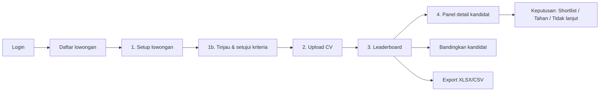

# 05 — UI/UX Flow & Screen Spec

Bahasa UI: **Indonesia**. Desktop-first (lebar ≥ 1280 px), tetap bisa dibuka di laptop 1366 px.
Komponen: React + Tailwind + TanStack Table + pdf.js.

## 1. Alur utama

Upload CV boleh dilakukan sebelum kriteria disetujui (ingestion jalan di belakang). Tombol
**"Mulai screening"** baru aktif kalau kriteria sudah disetujui **dan** minimal 1 CV berstatus siap.

## 2. Screen 1 — Setup lowongan

- Field: Judul posisi (wajib), Lokasi, Tipe kerja, **Deskripsi lowongan** (textarea besar, atau upload
  PDF/DOCX).
- Field cepat (opsional, mengisi draf kriteria): minimal pengalaman (tahun), skill wajib (chip input),
  skill nilai tambah, jenjang pendidikan.
- Tombol: **"Buat draf kriteria"** → spinner "Menyusun kriteria dari deskripsi lowongan…" (< 60 dtk).

## 3. Screen 1b — Tinjau & setujui kriteria (wajib, tidak ada di draf awal)

Tabel yang bisa diedit:

| Kolom | Kontrol |
| --- | --- |
| Kriteria | Teks, bisa diedit |
| Kategori | Dropdown: Pengalaman / Hard skill / Pendidikan & sertifikasi / Pencapaian & kepemimpinan |
| Tingkat | Dropdown: Wajib / Diutamakan / Nilai tambah |
| Bobot | Angka; total ditampilkan di bawah dan harus = 100 (tombol "Normalisasi ke 100") |
| Parameter | Mis. minimal bulan, alternatif yang diterima (chip) |
| Sumber di JD | Kutipan kalimat JD (abu-abu) |

- Bar ringkas bobot per kategori (40/30/15/15 default) di atas tabel.
- Kriteria terlarang tampil merah dengan pesan: *"Kriteria usia tidak boleh dipakai untuk menilai kandidat.
  Hapus kriteria ini untuk melanjutkan."* Tombol setujui nonaktif sampai dihapus.
- Peringatan kuning untuk kriteria berisiko (nama kampus, IPK minimum): bisa tetap dipakai, tapi harus
  dicentang "Saya paham kriteria ini berisiko bias".
- Tombol **"Setujui kriteria"** → konfirmasi: *"Kriteria akan dikunci (versi 1). Perubahan berikutnya
  membuat versi baru."*

## 4. Screen 2 — Upload CV (dropzone)

- Area drag-and-drop besar: "Tarik CV ke sini atau klik untuk memilih. PDF, DOCX, DOC, JPG, PNG, atau ZIP.
  Maks 10 MB per file."
- Progress total: **"Memproses 15/50 CV…"** + bar. Polling `GET /jobs/{id}/cvs/status` tiap 2 detik.
- Daftar file dengan status chip:
  - Siap (hijau) · Diproses (biru, animasi) · Perlu cek manual (oranye, dengan alasan) · Ditolak (merah,
    dengan alasan) · Duplikat (abu-abu, "sama dengan cv_andi.pdf").
- Alasan ditulis manusiawi: "PDF terkunci password — minta kandidat mengirim ulang", "Hasil scan kurang
  jelas — cek manual".
- Upload bisa ditambah kapan saja; screening berikutnya memakai semua CV yang siap.

## 5. Screen 3 — Leaderboard

Header: judul lowongan, versi kriteria, tanggal run, tombol **Jalankan ulang**, **Bandingkan (n)**,
**Export**.

Tab band: **Semua wajib terbukti (A)** · **1 wajib belum terbukti (B)** · **Prioritas rendah (C)** ·
**Perlu cek manual** · **Belum dinilai** (masing-masing dengan jumlah).

Kolom tabel:

| Kolom | Isi |
| --- | --- |
| ☐ | Checkbox untuk bandingkan |
| # | Peringkat dalam run |
| Kandidat | `C-0007` saat blind mode; nama setelah "Tampilkan identitas" |
| Skor | Angka besar + warna (≥ 75 hijau, 50–74 kuning, < 50 merah). Ikon ⓘ kalau dibatasi cap, tooltip alasannya |
| Kriteria wajib | Mis. "3/3 terbukti" dengan titik warna per kriteria |
| Rincian | Mini bar 4 kategori |
| Rekomendasi | Chip: Disarankan shortlist / Perlu ditinjau / Prioritas rendah / Perlu cek manual |
| Flag | Ikon untuk teks tersembunyi, kemungkinan duplikat, confidence rendah |
| Keputusan | Kosong / Shortlist / Tahan / Tidak lanjut (oleh siapa) |

- Filter: rekomendasi, keputusan, flag, skill tertentu "terbukti".
- Toggle **Blind mode** (default ON). Mematikannya memunculkan dialog dan tercatat di audit log.
- Banner kecil tetap di atas tabel: *"Peringkat ini rekomendasi berbasis bukti CV. Keputusan ada di tangan
  Anda."*

## 6. Screen 4 — Panel detail kandidat (drawer kanan, lebar 55%)

Bagian atas: kode/nama, band, skor besar, rekomendasi, alasan cap kalau ada.

Tab:

1. **Ringkasan**: jabatan terakhir, total pengalaman relevan (dengan "dihitung dari peran bertanggal"),
   pendidikan, kelebihan (daftar dengan kutipan), belum terbukti, saran pertanyaan interview.
2. **Kartu skor**: tabel per kriteria → status (ikon + teks: Terbukti / Sebagian / Tidak tercantum /
   Tidak diketahui), bobot, kutipan bukti (klik → loncat ke halaman CV dan sorot), confidence (kecil), cara
   dinilai (aturan/verifier).
3. **CV asli**: viewer pdf.js dengan highlight kutipan; DOCX ditampilkan sebagai PDF hasil konversi atau
   teks. Kalau file hasil scan: tampilkan gambar + teks OCR berdampingan.
4. **Riwayat**: keputusan, komentar hiring manager, perubahan antar run.

Bawah (sticky): tombol **Shortlist**, **Tahan**, **Tidak lanjut** (wajib pilih alasan), kotak komentar.

Aturan bahasa di panel:

- Pakai "Tidak tercantum di CV", jangan "Tidak menguasai".
- Pakai "Hanya tercantum di daftar skill", jangan "Lemah di Python".
- Tidak ada kata tentang kepribadian, penampilan, usia, atau asal.

## 7. Bandingkan kandidat

2–4 kandidat berdampingan. Baris = kriteria, kolom = kandidat, sel = status + kutipan singkat. Baris dengan
selisih terbesar (bobot × selisih nilai) disorot. Kalimat ringkas di atas: *"C-0003 unggul di R3 (Python di
pekerjaan) dan R9 (pencapaian terukur); C-0012 unggul di R10 (memimpin tim)."*

## 8. Export

Modal: pilih format (XLSX/CSV), cakupan (semua / band A–B / yang di-shortlist), sertakan nama (hanya jika
blind mode dimatikan). Isi file: 04_DATA_MODEL_API_CONTRACT.md bagian 6.

## 9. State kosong, loading, dan error

| Situasi | Tampilan |
| --- | --- |
| Belum ada CV | Ilustrasi + "Belum ada CV. Upload untuk mulai." |
| Kriteria belum disetujui | Tombol screening nonaktif + tautan "Tinjau kriteria" |
| Screening berjalan | Skeleton table + "Menilai 120 kandidat…" |
| Semua kandidat band C | Pesan netral: "Belum ada kandidat yang memenuhi semua kriteria wajib. Pertimbangkan meninjau kriteria wajib." |
| LLM tidak tersedia | Screening tetap jalan dengan aturan saja; banner "Verifikasi lanjutan sedang tidak tersedia; beberapa kriteria ditandai perlu dicek." |
| Error server | Toast + kode error, tidak kehilangan input |

## 10. Aksesibilitas dan detail visual

- Warna skor selalu disertai angka dan teks (jangan hanya warna).
- Kontras teks minimal 4.5:1; navigasi keyboard untuk tabel dan drawer.
- Format tanggal Indonesia ("9 Okt 2026"), angka desimal koma.
